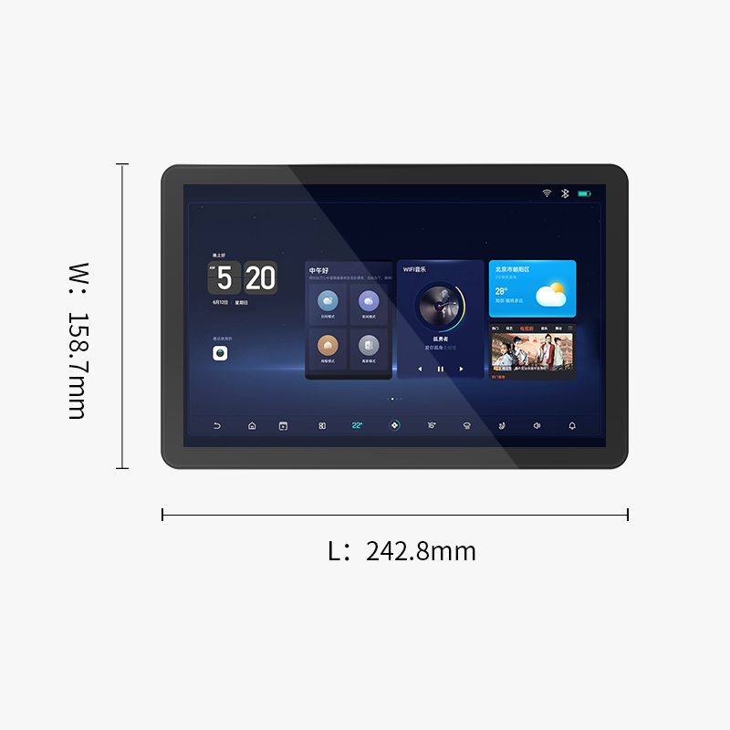
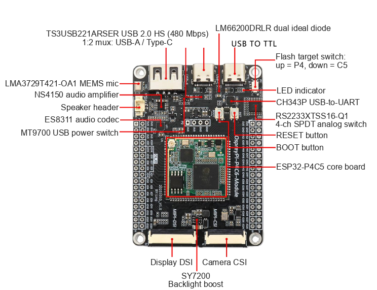
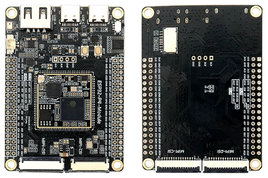

# ESP32-P4 DRO (Digital Readout) & Electronic Leadscrew (work in progress) 

This project provides a complete Digital Readout (DRO) and Electronic Leadscrew (ELS) system for milling machines and lathes, running on a 10.1-inch ESP32-P4 display board. Two carrier boards are supported and selected at build time: the Guition JC8012P4A1C (JD9365 panel, ESP32-P4 + ESP32-C6) and the osptek ESP32-P4C5 module (JD9366 panel with in-cell touch, ESP32-P4 rev v3.2 + ESP32-C5 dual-band). It features a modern, high-performance HMI built with LVGL 9.2, designed with a **"Smart Client, Dumb Backend"** philosophy. Both boards run the UI in horizontal mode without tearing.

## 🏗️ System Architecture (not fully implemented yet)

- **Frontend (HMI)**: The 10.1-inch P4 Display calculates all math (ABS/INC, PCD, Tapers, Threading Ratios) locally.
- **Backend (Hardware Controller)**: A separate ESP32 handles rapid pulse-counting (PCNT) from glass scales/encoders and outputs motor control signals (RMT/MCPWM) to stepper drivers.
- **Communication**: The system uses a reliable **USB HID** protocol instead of legacy UART to transmit configuration, axis telemetry, and synchronization data between the display and the motion controller.
- **Not all the calculation are finished**: The UI is up but not all buttons have functionality. The communication between frontend and backend works on High Speed USB but shoul be used a dumb cable. Not all cable
- work 
---

## 🖥️ The Frontend (HMI)

Two 10.1-inch ESP32-P4 carrier boards are supported, selected at build time. Both run the
same 1280x800 landscape UI and the same application code; they differ in panel controller,
touch controller, radio and P4 revision only.

### 1. JC8012P4A1C (Guition) -- `DRO_BOARD=guition` (default)

- **Panel**: 1280x800 MIPI-DSI, **JD9365** controller, rotated 270 deg on the CPU
- **Touch**: **GSL3680** capacitive, separate controller
- **Radio**: ESP32-C6 (2.4 GHz) over SDIO; co-processor built from `esp32c6_hosted_cp/`
- **P4**: rev < 3.0
- **Build**: `idf.py build` -- uses the tracked `sdkconfig`

Rotation is where most 10.1-inch ESP32-P4 builds get stuck. This one runs its 270 deg
landscape rotation in LVGL on the CPU (PPA disabled), which on this panel gives a stable
horizontal image without tearing -- the result looks effortless precisely because it is not.



### 2. osptek ESP32-P4C5 module -- `DRO_BOARD=osptek`

- **Panel**: 1280x800 MIPI-DSI, **JD9366** controller, rotated 90 deg on the PPA
- **Touch**: **JD9366 in-cell**, shares the I2C bus with the ES8311 codec
- **Radio**: **ESP32-C5**, Wi-Fi 6 dual-band 2.4 + 5 GHz, over SDIO
- **P4**: rev v3.2
- **Build**: `idf.py -B build_osptek -DDRO_BOARD=osptek build` -- uses `sdkconfig.osptek`





The C5 leaves the factory with a **blank flash**: the co-processor image in
[`firmware/`](firmware/README.md) has to be written before the hosted link exists at all.
How the board was brought up, and why the two profiles exist:
[`docs/board-port.md`](docs/board-port.md).

### Side by side

| | Guition JC8012P4A1C | osptek ESP32-P4C5 |
| :--- | :--- | :--- |
| Panel controller | JD9365 | JD9366 |
| Touch | GSL3680 (separate IC) | JD9366 in-cell |
| Rotation | 270 deg, CPU | 90 deg, PPA |
| Radio | ESP32-C6, 2.4 GHz | ESP32-C5, 2.4 + 5 GHz |
| P4 revision | rev < 3.0 | rev v3.2 |
| sdkconfig | `sdkconfig` | `sdkconfig.osptek` |
| Build | `idf.py build` | `-DDRO_BOARD=osptek` |

The rotation and touch orientation belong to the board, not to the app: the BSP applies
`BSP_LCD_ROTATION` (and matching touch flags) so the UI is upright and the touch mapping is
correct on both.

### Where to buy / vendor documentation

- **osptek ESP32-P4C5 module and carrier** -- the board in section 2:
  [GitHub](https://github.com/osptek/devboard-esp32p4c5_module) ·
  [Gitee](https://gitee.com/osptek/devboard-esp32p4c5_module)
- **Guition JC8012P4A1C** -- the board in section 1, sold through Taobao / AliExpress resellers.

Both are bought through Chinese marketplaces. Product links are deliberately left out: individual
listings expire, differ per region, and often ship a different panel than the photo suggests.

> **Similar-looking boards are not drop-in compatible.** Several 10.1-inch ESP32-P4 carriers look
> alike (Waveshare and other resellers of the same reference design), and they are close enough to
> be tempting -- but four things decide whether a build works, and all four differ between the two
> boards here: the panel controller (JD9365 vs JD9366), the touch arrangement (separate GSL3680 vs
> JD9366 in-cell), the P4 revision (rev < 3.0 vs v3.2, mutually exclusive images) and the radio
> co-processor (C6 vs C5). Check those before assuming compatibility.

---

## 🚀 Key Features

- ✅ **HMI-Centric Design**: All math (ABS/INC, PCD, Tapers) happens on the display unit.
- ✅ **Multi-Axis Support**: 5 virtual axes (X, Y, Z, W, C) + dedicated Spindle tracking with customizable mapping.
- ✅ **Button-Tap Centric UI**: The UI has been rigidly locked to prevent accidental horizontal swiping/sliding on settings tabs, optimized for industrial machine screens with dirty/gloved hands.
- ✅ **Electronic Leadscrew (ELS)**: Stepper synchronization for threading, follow mode, and conical turning operations directly through the ESP32 backend.
- ✅ **USB HID Bridge**: No fragile RS485/UART wiring required. The display and backend talk natively over a customized standard USB connection.

---

## 📦 Project Structure

```text
DRO-10.1-inch/
├── components/
│   ├── esp32_p4_function_ev_board/   # BSP: both boards (choice BSP_BOARD)
│   ├── esp_lcd_jd9365/               # JD9365 panel driver (Guition board)
│   ├── esp_lcd_jd9366/               # JD9366 panel + in-cell touch (osptek board)
│   ├── dro_system/                   # Core DRO business logic & Axis mapping
│   ├── eez/                          # LVGL UI implementation (Manual C edits)
│   ├── frontend_usb/                 # USB Host HID driver bridging
│   ├── machine_params/               # NVS storage for machine settings
│   ├── screw_calc/                   # Threading ratio calculator
│   └── cone_calc/                    # Taper turning calculator
├── esp32p4_usb_dro_backend/          # THE UNIFIED BACKEND REPOSITORY
│   ├── main/                         # USB Device HID stack & ELS algorithm
│   └── modules/BSP/                  # Multi-Board Support Package (Pinouts)
├── esp32c6_hosted_cp/                # ESP-Hosted co-processor firmware for the C6
├── firmware/                         # Prebuilt C5 co-processor image + flashing notes
├── docs/board-port.md                # How the second board was brought up
├── sdkconfig                         # Guition profile (DRO_BOARD=guition)
├── sdkconfig.osptek                  # osptek profile (DRO_BOARD=osptek)
└── README.md                         # This file
```

---

## 🔌 Encoder Architecture & Pin Mapping

### Encoder Decoder Architecture

The backend uses a **Hybrid PCNT / Software ISR** strategy to work around the 4-unit PCNT hardware limit on ESP32-P4 and ESP32-S3 silicon:

| Axis | Role | Decoder Method | Reason |
| :--- | :--- | :--- | :--- |
| **Spindle** | Threading sync (ELS) | Hardware PCNT | Must be fastest — drives ISR DDA math |
| **X** | Linear scale | Hardware PCNT | Primary machine axis |
| **Y** | Linear scale | Hardware PCNT | Primary machine axis |
| **Z** | Linear scale | Hardware PCNT | Primary machine axis |
| **W** | Linear scale | **Software GPIO ISR** | No PCNT units remaining; SW ISR sufficient for slow carriage |
| **C** | Rotary / 4th axis | **Software GPIO ISR** | No PCNT units remaining; SW ISR sufficient |

> [!NOTE]
> The Software GPIO ISR uses `GPIO_INTR_ANYEDGE` on both A and B pins for full **4X quadrature resolution**, identical to hardware PCNT. It is placed in IRAM (`ESP_INTR_FLAG_IRAM`) and runs safely during USB operations. Typical machine traverse speeds are well under 50kHz, making SW ISR completely reliable.

---

### Encoder Pin Connections by Board

#### ESP32-P4C6-osprey Baseboard

| Signal | Pin A | Pin B | Notes |
| :--- | :---: | :---: | :--- |
| **Spindle** | IO0 | IO1 | HW PCNT — Index Z on IO2 |
| **Axis X** | IO3 | IO4 | HW PCNT |
| **Axis Y** | IO5 | IO6 | HW PCNT |
| **Axis Z** | IO14 | IO15 | HW PCNT |
| **Axis W** | IO16 | IO17 | SW GPIO ISR |
| **Axis C** | IO18 | IO19 | SW GPIO ISR |

| Stepper | STEP | DIR |
| :--- | :---: | :---: |
| **Axis X** | IO23 | IO24 |
| **Axis Y** | IO25 | IO27 |
| **Axis Z** | IO28 | IO29 |
| **Axis W** | IO30 | IO31 |
| **Axis C** | IO34 | IO35 |
| **Enable (all)** | IO22 | — |

---

#### ESP32-P4 WT9932P4-TINY

| Signal | Pin A | Pin B | Notes |
| :--- | :---: | :---: | :--- |
| **Spindle** | IO0 | IO1 | HW PCNT — Index Z on IO2 |
| **Axis X** | IO3 | IO4 | HW PCNT |
| **Axis Y** | IO5 | IO6 | HW PCNT |
| **Axis Z** | IO14 | IO15 | HW PCNT |
| **Axis W** | IO16 | IO17 | SW GPIO ISR |
| **Axis C** | IO18 | IO19 | SW GPIO ISR |

| Stepper | STEP | DIR | Notes |
| :--- | :---: | :---: | :--- |
| **Axis X** | IO23 | IO10 | DIR moved from IO24 (USB D+) |
| **Axis Y** | IO11 | IO27 | STEP moved from IO25 (USB D-) |
| **Axis Z** | IO28 | IO29 | |
| **Axis W** | IO30 | IO31 | |
| **Axis C** | IO34 | IO12 | DIR moved from IO35 (BOOT button) |
| **Enable (all)** | IO22 | — | |

> [!WARNING]
> **IO51** on the TINY board is hardwired to the onboard **WS2812 RGB LED**. Do not use IO51 for RS485 or any other output.

---

#### ESP32-S3-DevKitC-1 N16R8

> [!NOTE]
> **S3 BSP status**: The GPIO mapping below is now implemented in `bsp.h`. Select `BOARD_ESP32S3` in `idf.py menuconfig` then build and flash — no further pin configuration required unless your wiring differs.

**Avoid these pins on the N16R8:**
- `GPIO 26–37`: Internally wired to Octal-SPI Flash and 8MB PSRAM. **Will crash firmware.**
- `GPIO 19, 20`: Native USB D+/D-. Needed for HID communication.
- `GPIO 0, 3, 45, 46`: Boot strapping pins.

| Signal | Pin A | Pin B | Notes |
| :--- | :---: | :---: | :--- |
| **Spindle** | IO1 | IO2 | HW PCNT |
| **Axis X** | IO4 | IO5 | HW PCNT |
| **Axis Y** | IO6 | IO7 | HW PCNT |
| **Axis Z** | IO8 | IO9 | HW PCNT |
| **Axis W** | IO10 | IO11 | SW GPIO ISR |
| **Axis C** | IO12 | IO13 | SW GPIO ISR |

| Stepper | STEP | DIR |
| :--- | :---: | :---: |
| **Axis X** | IO38 | IO39 |
| **Axis Y** | IO40 | IO41 |
| **Axis Z** | IO42 | IO43 |
| **Axis W** | IO44 | IO47 |
| **Axis C** | IO48 | IO21 |
| **Enable (all)** | IO14 | — |

## 💻 Development

### Compiling the Backend

The Backend uses ESP-IDF's Target and Kconfig systems to select the physical board logic at compile-time.

```bash
# 1. Set your silicon target (e.g. esp32p4 or esp32s3)
idf.py set-target esp32p4

# 2. Open the Configuration Menu to select the EXACT board
idf.py menuconfig
# -> Navigate to "E-Leadscrew Hardware Selection"
# -> Choose "ESP32-P4 WT9932P4-TINY" or "ESP32-P4C6-osprey Baseboard"

# 3. Build & Flash
idf.py build flash monitor
```

> [!WARNING]
> Ensure you plug the USB cable into your **FS (Full-Speed / JTAG)** port when flashing the backend board, but plug the display (or PC for testing) into the **HS (High-Speed / OTG)** port for the USB HID protocol to communicate!

## 🛣️ Implementation Roadmap

### ✅ What is Working Right Now

- **The Modern LVGL 9.2 Frontend**: Fast, dark-mode styling, and entirely button-driven navigation optimized to prevent accidental gestures in an industrial shop environment.
- **Smart Math Core**: Fully decoupled local math inside the display processor handling all PCD, Taper, and ABS/INC calculations.
- **USB HID Bridge**: A stable, high-speed custom USB HID datalink connecting the Frontend Display directly to the Backend microcontrollers, fully deprecating the legacy FPGA/RS485 setups.
- **Multi-Board SDK Architecture**: The backend successfully targets custom ESP32-P4 footprints (Osprey, TINY) and legacy S3 boards via a clean Kconfig matrix that automatically patches pinouts at compile-time to prevent hardware conflicts.
- **Dual Firmware Roles (Kconfig)**: The same codebase flashes as either a full DRO/ELS Backend or a lightweight Spindle Pulse Generator for Hardware-in-the-Loop (HIL) testing — no second repository needed.
- **Pulse Counting (PCNT)**: Hardware quadrature decoding using the ESP32's native PCNT peripherals to track physical glass scales.
- **PCNT Infinite-Range Overflow Compensation**: Hardware watchpoint callbacks (`CONFIG_PCNT_ISR_IRAM_SAFE`) maintain a 64-bit software accumulator per axis, giving truly infinite travel range without delta-unwrapping hacks.
- **50kHz GPTimer DDA Stepper Engine**: A bare-metal hardware timer ISR fires 50,000 times per second to run the Bresenham Digital Differential Analyzer, generating perfectly timed 20µs STEP pulses synchronized to the spindle encoder — all without blocking FreeRTOS.

### 🚧 What is Not Yet Tested / Hardware Pending

- **HIL Loopback Validation**: Hardware wiring not yet connected. The `[HIL]` console printouts are in place — pending jumper wires from STEP_X output back into ENC_X_A input.
- **Open-Loop ELS Mode**: Algorithm is implemented in the GPTimer ISR. Needs physical spindle encoder wired to Spindle PCNT pins to validate.
- **Closed-Loop Feedback Algorithm**: Architecture is ready. Error-correction logic between `target_steps_generated` and the loopback PCNT axis count to be implemented after HIL validation confirms open-loop is correct.
- **Hardware Machine Interlocks**: Complete bridging of physical Limit Switches and E-Stop pins into the LVGL warning dialogs.

## 📋 Development Log

### 2026-04-02 — ELS Motor Engine & HIL Architecture

#### Board Support & Build System

- Renamed `BOARD_ESP32P4_EVO` → `CONFIG_BOARD_ESP32P4C6_OSPREY` across `Kconfig.projbuild` and `bsp.h` to match the physical board branding.
- Added a second Kconfig dimension: **`ROLE_TARGET`** — the same binary can now be flashed as either the full `DRO/ELS Backend` or a lightweight `HIL Test Generator` (no second repository needed).
- Created `generator_main.c`: a FreeRTOS task that outputs realistic A/B quadrature pulses on the Spindle PCNT pins to simulate a spinning lathe chuck during bench testing.

#### PCNT Overflow & Infinite-Range Positioning

- Discovered the ESP32-P4 has only **4 PCNT hardware units** (down from 8 on classic ESP32). Resolved by reserving 3 units for axes (X, Y, Z) and 1 for the Spindle.
- Replaced naive 16-bit counter reads with a proper **hardware watchpoint + IRAM-safe ISR** overflow system:
  - `pcnt_unit_add_watch_point()` registers triggers at `±32000`.
  - A shared `IRAM_ATTR pcnt_overflow_cb()` atomically adjusts a per-unit `int64_t` software accumulator on every hardware overflow.
  - True absolute position is always `hw_count + overflow_accum` — effectively infinite travel range.
  - `CONFIG_PCNT_ISR_IRAM_SAFE=y` added to `sdkconfig.defaults` so callbacks fire reliably even during TinyUSB flash cache flushes.

#### 50kHz GPTimer DDA Stepper Engine

- Replaced the old simulated FreeRTOS while-loop step generator with a **real-time bare-metal `gptimer` ISR** running at **50,000 Hz** (20 µs period).
- Each ISR tick runs the **Bresenham Digital Differential Analyzer (DDA)**:
  1. Reads the absolute spindle position.
  2. Computes the movement delta since the last tick.
  3. Adds `delta × ratio` to a Q16.16 fixed-point phase accumulator.
  4. When the accumulator overflows `1.0`, fires one 20 µs STEP pulse and updates the DIR pin.
- This approach delivers mathematically perfect spindle synchronization with zero buffering latency (no RMT buffers, no MCPWM restarts).
- The FreeRTOS `backend_els_task` is now a slow 100 Hz background loop handling only acceleration ramping, USB telemetry, and HIL printouts.

#### HIL Validation Printouts

- Added `[HIL]` 1 Hz console log comparing `target_steps_generated` vs absolute loopback PCNT count to validate the full open-loop round trip once hardware is wired.

**Status at end of session:** Compiles and runs stable on ESP32-P4. Hardware wiring pending.

---

## 📄 License

This project follows the same license terms as the original ESP-IDF examples.
